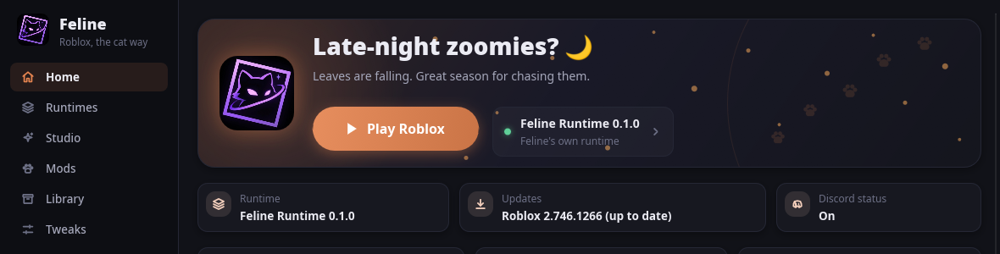
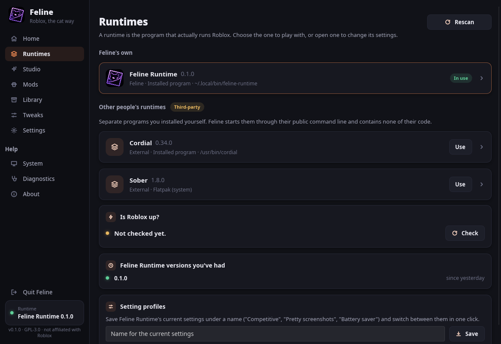
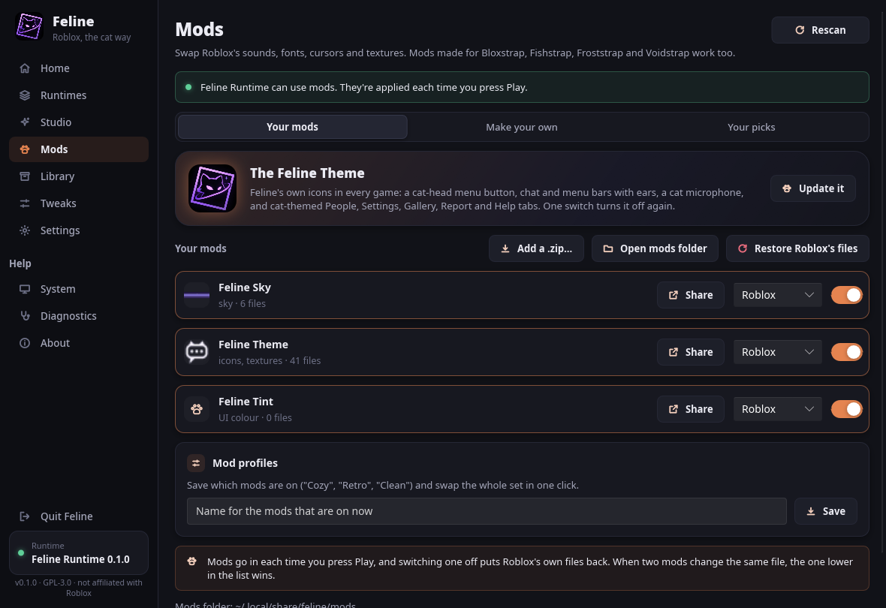
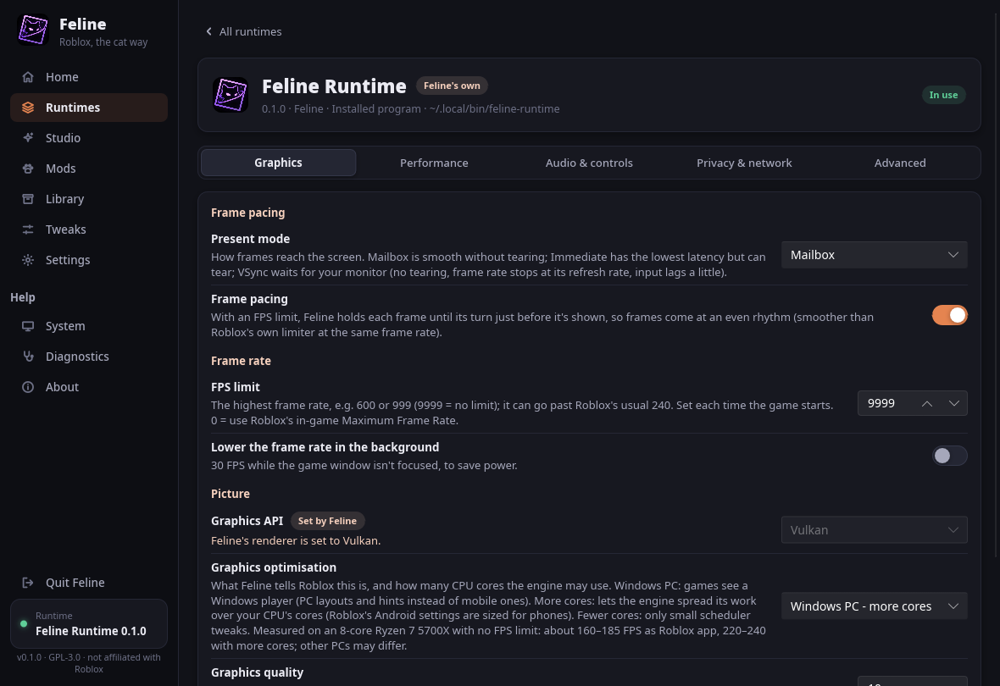

# Feline

A cat-shaped launcher for Roblox on Linux and Windows, with its own runtime
for Linux. Always lands on its feet.



- **On Linux**, Feline plays Roblox with **its own runtime**, which runs
  Roblox's Android app in a desktop window. It can also start a runtime made
  by someone else, if you have one installed.
- **On Windows**, Feline starts Roblox's official client and adds its extras
  around it.

**Unofficial project, not affiliated with Roblox Corporation.** Roblox does not
support third-party clients; read [docs/LEGAL.md](docs/LEGAL.md) for the
account risks before using it. Feline ships no Roblox files and never asks for
your password or Robux.

## Contents

- [Install on Linux](#install-on-linux)
- [Install on Windows](#install-on-windows)
- [What the launcher does](#what-the-launcher-does)
- [Feline's own runtime](#felines-own-runtime-linux)
- [Not tested yet](#not-tested-yet)
- [Known problems](#known-problems)
- [Updating](#updating)

## Install on Linux

There is no ready-made download for Linux yet: you build Feline from its
source. It needs a 64-bit Intel/AMD PC, Vulkan (or OpenGL ES) graphics
drivers, PulseAudio or PipeWire for sound, and Rust 1.99 or newer.

### Arch Linux and relatives (CachyOS, EndeavourOS, Manjaro)

```sh
git clone https://github.com/TerrariaLoverForever/feline
cd feline/packaging/aur
makepkg -si
```

That builds and installs the `feline-git` package: the launcher, Feline's
runtime and its login window. Remove it with `sudo pacman -R feline-git`.
More in [packaging/aur](packaging/aur/README.md).

### Any distribution

1. Install the build tools and libraries. On Arch:

   ```sh
   sudo pacman -S --needed rust git pkgconf alsa-lib fontconfig freetype2 \
     libxkbcommon wayland libpulse vulkan-icd-loader gtk4 webkitgtk-6.0 xdg-utils
   ```

   Other distributions have the same things under their own names: the
   development packages of ALSA, fontconfig, freetype, xkbcommon, Wayland,
   PulseAudio, GTK 4 and WebKitGTK 6.0, plus a Vulkan loader.

2. Build and install for your user:

   ```sh
   git clone https://github.com/TerrariaLoverForever/feline
   cd feline
   cargo build --release
   install -Dm755 target/release/feline target/release/feline-runtime \
     target/release/feline-login -t ~/.local/bin/
   feline --install-desktop-entry      # adds Feline to your app menu
   ```

   (`~/.local/bin` has to be on your `PATH`.)

3. Open Feline, go to **Runtimes** and press **Use** on *Feline Runtime*.
   The first Play downloads Roblox's Android app, checks that it is really
   signed by Roblox, and opens a window to sign in on Roblox's own website.

To use a runtime made by someone else instead, install it yourself and pick
it on the same page:

| Runtime | Feline can… |
|---|---|
| [Sober](https://sober.vinegarhq.org) | play, join links, edit its settings |
| [Cordial](https://github.com/luohoa97/cordial) | play, join links, edit its settings, run its self-check |
| [Stud](https://github.com/CatPieLeaf/Stud) | play, join links, edit its settings |
| [Tipsy](https://github.com/32bitx64bit/Tipsy) | play, join links |
| [Mocktail](https://github.com/komaruworld/mocktail) | play, join links |
| [Nightcap](https://github.com/CoderDayton/nightcap) | play, join links |

Feline never picks one for you and starts them only through their public
command line.

## Install on Windows

Roblox's official client has to be installed first (from roblox.com): Feline
starts that copy and ships none of Roblox's files.

No release has been published yet, so for now `feline.exe` is built from
source (Rust 1.92 or newer):

1. Install [Rust](https://rustup.rs) (it offers to install Microsoft's C++
   build tools; say yes) and [Git](https://git-scm.com/download/win).
2. In PowerShell:

   ```powershell
   git clone https://github.com/TerrariaLoverForever/feline
   cd feline
   cargo build --release -p feline
   ```

3. Run `target\release\feline.exe`. It's a single file: put it wherever you
   like and make a shortcut to it.

Once releases exist, `feline.exe` and its SHA-256 checksum will be on the
[Releases page](https://github.com/TerrariaLoverForever/feline/releases), and
Feline will update itself from there.

## What the launcher does

<p>
  
  
</p>

**Playing**

- One-click Play, and your recently played games, favourites and time played
  on the Home page (read from Roblox's own logs).
- The servers you were on, with where they are, **Rejoin** and **Copy
  invite**; a server picker with location and uptime.
- Desktop shortcuts that start one game straight away.
- "Play" on roblox.com can open through Feline (opt-in; switching it off
  gives the links back to the app that had them).
- Several Roblox accounts, and switching between them (Feline's runtime).

**Making it yours**

- **Mods:** swap Roblox's sounds, fonts, textures and cursors. Same folder
  layout as Bloxstrap, so mods made for Bloxstrap, Fishstrap, Froststrap and
  Voidstrap work, and their mods and settings can be imported. Mods work
  with Feline's runtime, Sober and (on Windows) the official client.
- **Library:** mods to add in one click, and mod profiles to swap a whole
  set at once.
- **The Feline Theme:** cat-shaped icons for Roblox's top bar and menu.
- Your own skybox, animated cursors (`.gif`, `.ani`) and UI colours.
- For Feline's window: accent colours, seasonal themes, fonts, backgrounds,
  background music, optional achievements.

**Settings in one place**

- Each runtime's own settings on its page, plus Feline-wide overrides.
  Feline only writes values it has checked the runtime accepts, keeps the
  rest of the file as it was, and makes a backup first.
- Saved sets of Roblox's settings, also per game; staying on a Roblox
  version; repairing Roblox's files.

**While you play**

- **Discord status:** the game's name, icon, creator and time played. Join
  button, username and avatar are opt-in. It runs in its own small process,
  so it keeps going when Feline's window is closed.
- CPU and memory of the game, a break reminder, and a tray icon that keeps
  Feline running in the background.
- Nothing animates while idle, so Feline uses no GPU time while you play.

**When something breaks**

- **System page:** can this PC run Roblox, driver check, live usage.
- **Diagnostics page:** quick checks, a crash detective that reads how your
  last sessions ended and what to try, a network test, "is Roblox up?", and
  a bug report with personal details removed.
- **Privacy and storage:** delete logs, clear the cache, forget the saved
  login, clear things when Feline closes.

**Windows only**

- **Tweaks:** the FastFlags Roblox still accepts, as friendly choices, with
  presets and per-game profiles.
- **Roblox Studio:** start it with your mods and its own flags, Discord
  status while you build.
- More than one Roblox at once, the game window's icon and title bar colour,
  which graphics card and priority the game gets.
- **Desk cat:** a little pixel cat that follows your pointer.

<p>
  
  
</p>

## Feline's own runtime (Linux)



`feline-runtime` loads the engine of Roblox's Android app and gives it what
it expects from Android (a window, input, sound, files, a Java world), on
top of ordinary Linux libraries.

- **Graphics:** Vulkan, with OpenGL ES as the other choice.
- **Frame rate:** an FPS limit of your choice, even frame pacing, present
  mode and VSync, a lower frame rate while the window is in the background.
- **Input:** keyboard and mouse with Roblox's desktop layout, the camera
  turns freely while you hold the right button (the pointer is held in
  place), typing and chat, copy and paste, F11 for fullscreen.
- **Sound** through PulseAudio or PipeWire.
- **Signing in** on Roblox's own website in a separate window; the session
  is kept between runs.
- **Roblox updates:** downloaded automatically, the signature checked
  against Roblox's own key, with the previous version kept to fall back on.
- **Mods**, the same ones as everywhere else.
- **Privacy:** Roblox's usage-statistics servers are blocked (can be turned
  off), a proxy can be set, Roblox's own screenshots and recordings can be
  blocked.
- **Tuning:** graphics quality, how many CPU threads and what priority
  Roblox gets, giving unused memory back, GameMode, MangoHud, vkBasalt.

## Not tested yet

These are written and built, but nobody has confirmed them in real use.
Expect rough edges, and please say what you find.

**Feline's runtime**

| Feature | What's missing |
|---|---|
| Controllers | No gamepad was connected while it was written |
| Voice chat | Not confirmed that other players hear you |
| First person and Shift Lock | The mouse lock is new; only the right-button camera is confirmed |
| CPU threads, priority, giving memory back | Not checked in a game |
| Blocking Roblox's screenshots and recordings | Not checked in a game |
| Proxy | Never used with a real proxy |
| vkBasalt, MangoHud, GameMode | Not checked in a game |
| Adding and switching a second account | Not done with a real second login |
| Falling back to the previous Roblox version | Never needed, so never run for real |
| X11 sessions | Only Wayland (KDE Plasma) has been used |
| AMD and Intel graphics | Only an NVIDIA card has been used |

**The launcher**

| Feature | What's missing |
|---|---|
| Stud, Tipsy, Mocktail, Nightcap | Finding and starting them was only tried with stand-in installs, not the real programs |
| Mods with Sober | Written from Sober's documentation, not tried on a real install |
| Feline updating itself | No release has been published yet, so there was nothing to update to |
| The release build (GitHub Actions) | Never run: no version has been tagged |
| The Arch package | The recipe is written; a full `makepkg` build hasn't been run |
| Studio's script status plugin (Windows) | Not tried in Studio |
| Everything Windows-only | Built and unit-tested automatically on every change, but not confirmed by hand on a Windows PC |

## Known problems

- Some games kick Feline's runtime with "Client out of sync" (error 267).
- Feline's runtime can't join a game from a link yet: it opens the app, and
  you pick the game there.
- No webcam (face tracking) in Feline's runtime.
- Games see Feline's runtime as an Android device, since that's the app it
  runs.
- The desk cat doesn't work on Linux (Wayland doesn't let a program follow
  the pointer).

## Updating

- **Built from source:** `git pull`, then build and install again. Close
  Feline first, also from its tray icon: closing the window keeps it running.
- **Arch package:** run `makepkg -si` again.
- **Roblox itself** (Feline's runtime): Feline looks for a new version when
  it opens. `feline --update-roblox` does it by hand.

Text commands, handy for bug reports:

```sh
feline --info        # system information
feline --runtimes    # runtimes Feline found, numbered
feline --doctor N    # run runtime N's self-check (Cordial)
```

Feline's own files on Linux: settings in `~/.config/feline/`, game logs in
`~/.local/state/feline/logs/`, mods and Roblox's app in
`~/.local/share/feline/`.

## Community

Feline's official group on Roblox:
[FelineClient](https://www.roblox.com/communities/618646286/FelineClient#!/about)
(news, help and feedback).

## Documentation

- [Architecture](docs/ARCHITECTURE.md)
- [Legal notes and account risk](docs/LEGAL.md)
- [Contributing](CONTRIBUTING.md) (DCO sign-off, rules for runtime work)
- [Name and logo policy](TRADEMARKS.md)

## Credits

Key and gamepad mappings and the order of some of Roblox's input calls
follow [Mocktail](https://github.com/komaruworld/mocktail) (Apache-2.0).
The interface is built with [Slint](https://slint.dev).

## License

Copyright (C) 2026 The Feline contributors

Feline is free software: you can redistribute it and/or modify it under the
terms of the GNU General Public License as published by the Free Software
Foundation, either version 3 of the License, or (at your option) any later
version.

Feline is distributed in the hope that it will be useful, but WITHOUT ANY
WARRANTY; without even the implied warranty of MERCHANTABILITY or FITNESS FOR A
PARTICULAR PURPOSE. See the GNU General Public License for more details.

You should have received a copy of the GNU General Public License along with
Feline (see [COPYING](COPYING)). If not, see <https://www.gnu.org/licenses/>.

The Feline name and logo are not covered by the GPL; see
[TRADEMARKS.md](TRADEMARKS.md).
