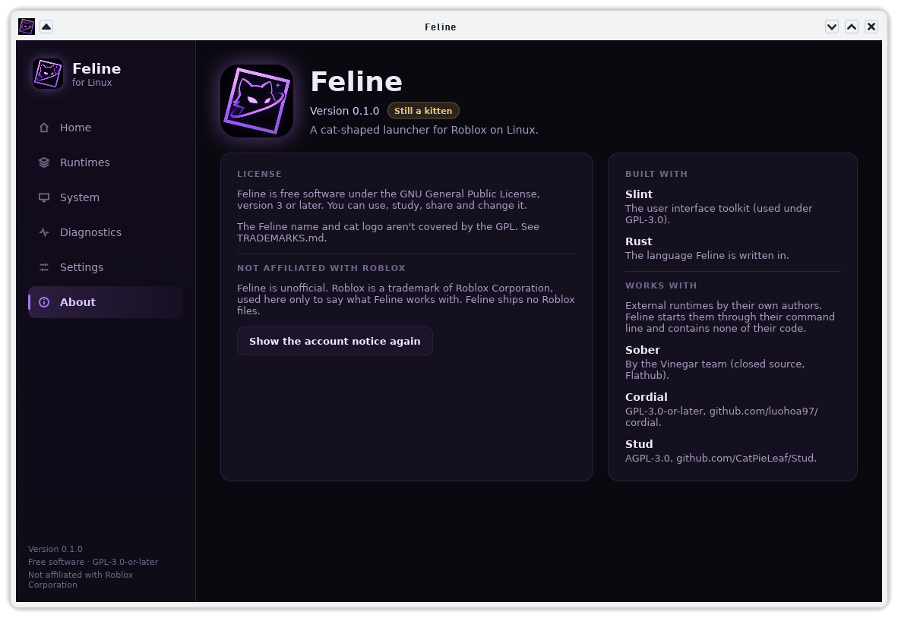

# Feline

A cat-shaped launcher for Roblox on Linux and Windows, with its own runtime
for Linux. Always lands on its feet.


- **On Linux**, Feline plays Roblox with **its own runtime**, which runs
  Roblox's Android app in a desktop window. It can also start a runtime made
  by someone else, if you have one installed.
- **On Windows**, Feline starts Roblox's official client and adds its extras
  around it.

**Unofficial project, not affiliated with Roblox Corporation.** Roblox does not
support third-party clients; read [docs/LEGAL.md](docs/LEGAL.md) for the
account risks before using it. Feline ships no Roblox files and never asks for
your password or Robux.

**Feline is new, so expect bugs.** Much of it has only been tried on one
PC so far (see [Not tested yet](#not-tested-yet)). If something breaks,
please say what happened: a bug report from the Diagnostics page helps a lot.

## Contents

- [Install](#install): [Linux](#linux), [Windows](#windows)
- [What the launcher does](#what-the-launcher-does)
- [Feline's own runtime](#felines-own-runtime-linux)
- [Not tested yet](#not-tested-yet)
- [Known problems](#known-problems)
- [Updating](#updating)
- [Text commands](#text-commands)

## Install

Ready-made programs for Linux and Windows are on the
[Releases](https://github.com/TerrariaLoverForever/feline/releases) page:
on Linux, unpack `feline-linux-x86_64.tar.gz`, put the three programs in
`~/.local/bin`, install the libraries from step 2 below and run
`~/.local/bin/feline --install-desktop-entry`; on Windows, run `feline.exe`.
On an ARM64 Linux PC, use `feline-linux-aarch64.tar.gz` the same way: it has
the launcher and login window but not Feline's own runtime, which runs
Roblox's x86-64 engine and so needs an x86-64 PC. On ARM, play through
another runtime, chosen in Feline.
There are no distribution packages yet. The steps below build Feline from
its source instead.

- [Linux](#linux)
- [Windows](#windows)

### Linux

Feline is built with cargo and installed into your home folder. It needs a
64-bit Intel/AMD PC and working Vulkan (or OpenGL ES) graphics drivers.

So far Feline has been built and used on **Arch Linux** only (KDE Plasma on
Wayland, an NVIDIA card). It should build on other distributions, but
nobody has tried yet; if you do, please say how it went.

1. Install Rust **1.99 or newer**. If your distribution's Rust is older, use
   [rustup](https://rustup.rs).

2. Install what Feline builds against and uses:

   ```sh
   # Arch Linux, CachyOS, EndeavourOS, Manjaro
   sudo pacman -S --needed base-devel git alsa-lib fontconfig freetype2 \
     libxkbcommon wayland gtk4 webkitgtk-6.0 libpulse vulkan-icd-loader xdg-utils

   # Debian, Ubuntu, Linux Mint (not tried yet)
   sudo apt install build-essential git pkg-config libasound2-dev \
     libfontconfig1-dev libfreetype-dev libxkbcommon-dev libwayland-dev \
     libudev-dev libgtk-4-dev libwebkitgtk-6.0-dev libpulse0 libvulkan1 xdg-utils

   # Fedora (not tried yet)
   sudo dnf install gcc git pkgconf-pkg-config alsa-lib-devel fontconfig-devel \
     freetype-devel libxkbcommon-devel wayland-devel systemd-devel gtk4-devel \
     webkitgtk6.0-devel pulseaudio-libs vulkan-loader xdg-utils
   ```

   On another distribution, install the same things under its own names:
   a C compiler, git, pkg-config, the development files of ALSA, fontconfig,
   freetype, xkbcommon, Wayland, udev, GTK 4 and WebKitGTK 6.0, and the
   PulseAudio and Vulkan libraries.

3. Build Feline and install it for your user:

   ```sh
   git clone https://github.com/TerrariaLoverForever/feline
   cd feline
   cargo build --release
   install -Dm755 -t ~/.local/bin target/release/feline \
     target/release/feline-runtime target/release/feline-login
   ~/.local/bin/feline --install-desktop-entry
   ```

   The last line adds Feline to your app menu.

4. Open **Feline** from your app menu and follow [First start](#first-start-on-linux).

- **Update:** quit Feline (also from its tray icon: closing the window keeps
  it running), `git pull` in the `feline` folder, then repeat step 3.
- **Remove:** `~/.local/bin/feline --uninstall-desktop-entry`, then delete the
  three programs from `~/.local/bin`.

A recipe for an Arch package (`feline-git`) is in
[packaging/aur](packaging/aur). It hasn't been built from start to finish
yet and isn't on the AUR, so the steps above are the way to install for now.

### First start on Linux

1. Go to **Runtimes** and press **Use** on *Feline Runtime*.
2. Press **Play Roblox**. The first time, Feline downloads Roblox's Android
   app (about 240 MB) and checks that it is really signed by Roblox.
3. A window opens for signing in on Roblox's own website. After that you
   stay signed in.

To play with a runtime made by someone else instead, install it yourself and
press **Use** on it on the same page:

| Runtime | Feline can… |
|---|---|
| [Sober](https://sober.vinegarhq.org) | play, join links, edit its settings |
| [Cordial](https://github.com/luohoa97/cordial) | play, join links, edit its settings, run its self-check |
| [Stud](https://github.com/CatPieLeaf/Stud) | play, join links, edit its settings |
| [Tipsy](https://github.com/32bitx64bit/Tipsy) | play, join links |
| [Mocktail](https://github.com/komaruworld/mocktail) | play, join links |
| [Nightcap](https://github.com/CoderDayton/nightcap) | play, join links |

Feline never picks one for you and starts them only through their public
command line.

### Windows

On Windows, Feline starts Roblox's official client, so that has to be
installed first, from [roblox.com](https://www.roblox.com/download).

1. Install [Git](https://git-scm.com/download/win) and
   [Rust](https://rustup.rs). Rust's installer offers to install Microsoft's
   C++ build tools; say yes.

2. In PowerShell:

   ```powershell
   git clone https://github.com/TerrariaLoverForever/feline
   cd feline
   cargo build --release -p feline
   ```

3. The program is `target\release\feline.exe`, a single file. Copy it
   wherever you like, make a shortcut to it, and open it.

- **Update:** quit Feline (also from its icon by the clock), `git pull` in
  the `feline` folder, then repeat steps 2 and 3.
- **Remove:** delete `feline.exe`. Feline's settings are in
  `%APPDATA%\Feline`.

## What the launcher does

<p>
  
  
</p>

**Playing**

- One-click Play, and your recently played games, favourites and time played
  on the Home page (read from Roblox's own logs).
- The servers you were on, with where they are, **Rejoin** and **Copy
  invite**; a server picker with location and uptime.
- Desktop shortcuts that start one game straight away.
- "Play" on roblox.com can open through Feline (opt-in; switching it off
  gives the links back to the app that had them), with the runtime you
  pick for links. Feline's own runtime opens Roblox's app and goes
  straight into that game.
- Several Roblox accounts, and switching between them (Feline's runtime).

**Making it yours**

- **Mods:** swap Roblox's sounds, fonts, textures and cursors. Same folder
  layout as Bloxstrap, so mods made for Bloxstrap, Fishstrap, Froststrap and
  Voidstrap work, and their mods and settings can be imported. Mods work
  with Feline's runtime, Sober and (on Windows) the official client.
- **Library:** mods to add in one click, and mod profiles to swap a whole
  set at once.
- **The Feline Theme:** cat-shaped icons for Roblox's top bar and menu.
- Your own skybox, animated cursors (`.gif`, `.ani`) and UI colours.
- For Feline's window: accent colours, seasonal themes, fonts, backgrounds,
  background music, optional achievements.

**Settings in one place**

- Each runtime's own settings on its page, plus Feline-wide overrides.
  Feline only writes values it has checked the runtime accepts, keeps the
  rest of the file as it was, and makes a backup first.
- Saved sets of Roblox's settings, also per game; staying on a Roblox
  version; repairing Roblox's files.

**While you play**

- **Discord status:** the game's name, icon, creator and time played. Join
  button, username and avatar are opt-in. It runs in its own small process,
  so it keeps going when Feline's window is closed.
- CPU and memory of the game, a break reminder, and a tray icon that keeps
  Feline running in the background.
- Nothing animates while idle, so Feline uses no GPU time while you play.
- **Desk cat:** a little pixel cat that follows your pointer around the
  desktop. On Linux it needs a Wayland desktop with layer-shell windows
  (KDE Plasma, Hyprland, Sway and most others; not GNOME, not X11). It
  follows the pointer on KDE Plasma and Hyprland; elsewhere it wanders
  around the screen on its own.

**When something breaks**

- **System page:** can this PC run Roblox, driver check, live usage.
- **Diagnostics page:** quick checks, a crash detective that reads how your
  last sessions ended and what to try, a network test, "is Roblox up?", and
  a bug report with personal details removed.
- **Privacy and storage:** delete logs, clear the cache, forget the saved
  login, clear things when Feline closes.

**Windows only**

- **Tweaks:** the FastFlags Roblox still accepts, as friendly choices, with
  presets and per-game profiles.
- **Roblox Studio:** start it with your mods and its own flags, Discord
  status while you build.
- More than one Roblox at once, the game window's icon and title bar colour,
  which graphics card and priority the game gets.

<p>
  
  
</p>

## Feline's own runtime (Linux)


`feline-runtime` loads the engine of Roblox's Android app and gives it what
it expects from Android (a window, input, sound, files, a Java world), on
top of ordinary Linux libraries.

- **Graphics:** Vulkan, with OpenGL ES as the other choice.
- **Frame rate:** an FPS limit of your choice, even frame pacing, present
  mode and VSync, a lower frame rate while the window is in the background.
- **Input:** keyboard and mouse with Roblox's desktop layout, the camera
  turns freely while you hold the right button (the pointer is held in
  place), first person and Shift Lock, typing and chat, copy and paste, F11
  for fullscreen, and controllers (gamepads).
- **Sound** through PulseAudio or PipeWire.
- **Signing in** on Roblox's own website in a separate window; the session
  is kept between runs.
- **Joining from a link:** the website's Play button (with Feline opening
  Roblox links), Rejoin and the server picker open the app and go straight
  into that game, once the app has reached its Home screen.
- **Roblox updates:** downloaded automatically, the signature checked
  against Roblox's own key, with the previous version kept to fall back on.
- **Mods**, the same ones as everywhere else.
- **Privacy:** Roblox's usage-statistics servers can be blocked (off unless
  you turn it on; read the note in [docs/LEGAL.md](docs/LEGAL.md) first), a
  proxy can be set, Roblox's own screenshots and recordings can be blocked.
- **Tuning:** graphics quality, how many CPU threads and what priority
  Roblox gets, giving unused memory back, GameMode, MangoHud, vkBasalt.

## Not tested yet

These are written and built, but nobody has confirmed them in real use.
Expect rough edges, and please say what you find.

**Feline's runtime**

| Feature | What's missing |
|---|---|
| Voice chat | Not confirmed that other players hear you |
| CPU threads, priority, giving memory back | Not checked in a game |
| Blocking Roblox's screenshots and recordings | Not checked in a game |
| Proxy | Never used with a real proxy |
| vkBasalt, MangoHud, GameMode | Not checked in a game |
| Adding and switching a second account | Not done with a real second login |
| Falling back to the previous Roblox version | Never needed, so never run for real |
| X11 sessions | Only Wayland (KDE Plasma) has been used |
| AMD and Intel graphics | Only an NVIDIA card has been used |

**The launcher**

| Feature | What's missing |
|---|---|
| Stud, Tipsy, Mocktail, Nightcap | Finding and starting them was only tried with stand-in installs, not the real programs |
| Desk cat on Linux | Tried on KDE Plasma (Wayland) only; following the pointer on Hyprland and wandering on other desktops haven't been tried |
| Mods with Sober | Written from Sober's documentation, not tried on a real install |
| Feline updating itself | Only one release so far, so there was nothing to update to yet |
| The Arch package | The recipe is written; a full `makepkg` build hasn't been run |
| Studio's script status plugin (Windows) | Not tried in Studio |
| Building on anything but Arch Linux | The Debian/Ubuntu and Fedora package lists were written from each distribution's package names, not run there |
| Everything Windows-only | Built and unit-tested automatically on every change, but not confirmed by hand on a Windows PC |

## Known problems

- Some games kick Feline's runtime with "Client out of sync" (error 267).
- No webcam (face tracking) in Feline's runtime.
- Games see Feline's runtime as an Android device, since that's the app it
  runs.
- The desk cat doesn't come out in X11 sessions or on GNOME (no
  layer-shell windows there).

## Updating

How to update Feline itself is at the end of each [install](#install)
section. Feline can also update itself from its releases (About → Updates), together with its runtime and login window on
Linux, checking each download against its published SHA-256 checksum.

Roblox, for Feline's runtime: Feline looks for a new version when it opens.
`feline --update-roblox` does it by hand.

## Text commands

Handy for bug reports:

```sh
feline --info        # system information
feline --runtimes    # runtimes Feline found, numbered
feline --doctor N    # run runtime N's self-check (Cordial)
```

Feline's own files on Linux: settings in `~/.config/feline/`, game logs in
`~/.local/state/feline/logs/`, mods and Roblox's app in
`~/.local/share/feline/`.

## Community

Feline's official group on Roblox:
[FelineClient](https://www.roblox.com/communities/618646286/FelineClient#!/about)
(news, help and feedback).

## Documentation

- [Architecture](docs/ARCHITECTURE.md)
- [Legal notes and account risk](docs/LEGAL.md)
- [Contributing](CONTRIBUTING.md) (DCO sign-off, rules for runtime work and their one exception)
- [Name and logo policy](TRADEMARKS.md)

## Credits

Feline's runtime was written with [Mocktail](https://github.com/komaruworld/mocktail)
and [Nightcap](https://github.com/CoderDayton/nightcap) (both Apache-2.0) as a
reference: key, mouse and gamepad mappings, the order of some of Roblox's
input, text and voice calls, and where Roblox keeps its frame-rate limit
follow them. The code is Feline's own; the details are in
[docs/LEGAL.md](docs/LEGAL.md#runtime-component-policy).
The interface is built with [Slint](https://slint.dev).

## License

Copyright (C) 2026 The Feline contributors

Feline is free software: you can redistribute it and/or modify it under the
terms of the GNU General Public License as published by the Free Software
Foundation, either version 3 of the License, or (at your option) any later
version.

Feline is distributed in the hope that it will be useful, but WITHOUT ANY
WARRANTY; without even the implied warranty of MERCHANTABILITY or FITNESS FOR A
PARTICULAR PURPOSE. See the GNU General Public License for more details.

You should have received a copy of the GNU General Public License along with
Feline (see [COPYING](COPYING)). If not, see <https://www.gnu.org/licenses/>.

The Feline name and logo are not covered by the GPL; see
[TRADEMARKS.md](TRADEMARKS.md).
