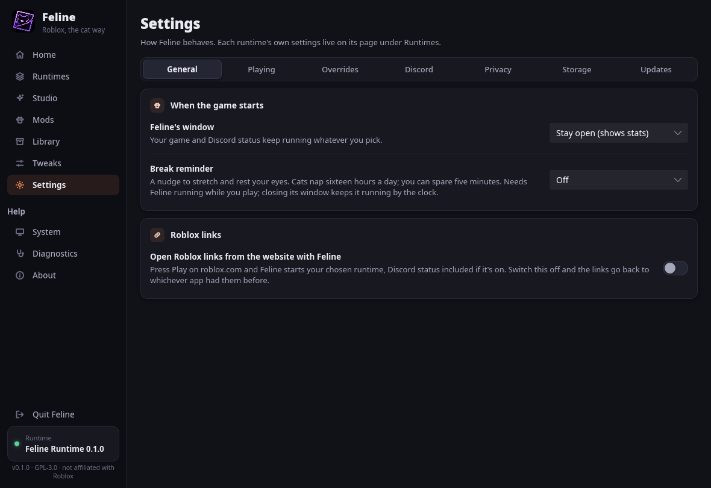

# Feline

A cat-shaped launcher for Roblox on Linux. Always lands on its feet.


> **Status: still a kitten (Milestone 1, the launcher).** The launcher works
> with external runtimes today. Feline's own runtime doesn't exist yet, and
> its Roblox compatibility has not been demonstrated. See the
> [roadmap](docs/ROADMAP.md).

Feline starts an **external third-party runtime** that you install yourself:

| Runtime | Install it from | Feline can… |
|---|---|---|
| [Sober](https://sober.vinegarhq.org) | Flathub | play, join links, edit its settings |
| [Cordial](https://github.com/luohoa97/cordial) | Flatpak, AppImage or package | play, join links, edit its settings (incl. FPS limit and present mode), run its self-check |
| [Stud](https://github.com/CatPieLeaf/Stud) | Flatpak, AppImage or package | play, join links, edit its settings |
| [Tipsy](https://github.com/32bitx64bit/Tipsy) | Flatpak, AppImage or package | play, join links |
| [Mocktail](https://github.com/komaruworld/mocktail) | Flathub, AppImage or package | play, join links |
| [Nightcap](https://github.com/CoderDayton/nightcap) | Flatpak, AppImage or package | play, join links |

Feline never picks a runtime for you, contains none of their code, and ships
no Roblox files.

**Unofficial project, not affiliated with Roblox Corporation.** Roblox does not
support third-party clients; read [docs/LEGAL.md](docs/LEGAL.md) for the
account risks before using it.

## What it does

- **Play and join:** one-click Play, or paste a `roblox.com/games/…` or
  `roblox://` link to join that experience.
- **Settings in one place:** each runtime's own settings, plus Feline-wide
  overrides (renderer, GameMode, close on leave) written into every runtime's
  file. Feline only writes values it has verified each runtime accepts, keeps
  everything else in the file as it was, and makes a backup first.
- **Discord status:** "Playing Feline" with the game's name, icon, creator and
  time played, for every runtime. Join button, username and avatar are opt-in.
  It runs in its own small process next to the game, so it keeps going when
  you close Feline's window, and ends with the game.
- **Roblox links (opt-in):** "Play" on roblox.com can open your chosen runtime
  through Feline. Feline gives the links back to the previous app when you
  switch it off.
- **Monitoring:** time played, CPU and memory of the whole game while it runs.
- **System and Diagnostics pages:** your hardware and session, quick checks
  (such as a Flatpak NVIDIA driver mismatch), the runtime's self-check, and a
  copyable bug report.
- **Light on resources:** nothing animates while idle, so Feline uses no GPU
  time while you play.

<p>
  
  
</p>

## Building

Requires Rust 1.92 or newer (a distribution-packaged toolchain is fine; rustup
is not needed) and a C compiler (for the TLS library). Tested on Void Linux
with KDE Plasma (Wayland) and an NVIDIA GPU; other distributions may need their
fontconfig, freetype and xkbcommon development packages.

```sh
cargo build --release
./target/release/feline                          # open the window
./target/release/feline --install-desktop-entry  # add Feline to your app menu
```

Text commands, handy for bug reports:

```sh
feline --info        # system information
feline --runtimes    # runtimes Feline found, numbered
feline --doctor N    # run runtime N's self-check (Cordial)
```

Feline's own files: settings in `~/.config/feline/settings.conf`, game session
logs in `~/.local/state/feline/logs/`.

## Documentation

- [Architecture](docs/ARCHITECTURE.md)
- [Roadmap](docs/ROADMAP.md)
- [Legal notes and account risk](docs/LEGAL.md)
- [Contributing](CONTRIBUTING.md) (DCO sign-off, clean-room rule)
- [Name and logo policy](TRADEMARKS.md)

## License

Copyright (C) 2026 The Feline contributors

Feline is free software: you can redistribute it and/or modify it under the
terms of the GNU General Public License as published by the Free Software
Foundation, either version 3 of the License, or (at your option) any later
version.

Feline is distributed in the hope that it will be useful, but WITHOUT ANY
WARRANTY; without even the implied warranty of MERCHANTABILITY or FITNESS FOR A
PARTICULAR PURPOSE. See the GNU General Public License for more details.

You should have received a copy of the GNU General Public License along with
Feline (see [COPYING](COPYING)). If not, see <https://www.gnu.org/licenses/>.

The Feline name and logo are not covered by the GPL; see
[TRADEMARKS.md](TRADEMARKS.md).
